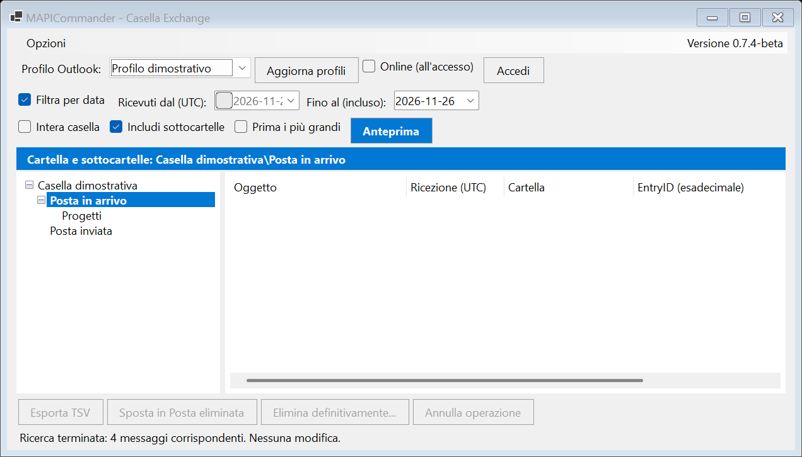

# MAPICommander 0.9 Beta

MAPICommander is a Windows tool for counting, listing, and removing email from Exchange. The desktop interface can search one folder, a folder and its subfolders, or an entire mailbox. The CLI works on one folder at a time. Both use the existing classic Outlook profile through Extended MAPI, not EWS, and do not require an Entra app registration.

> **Beta software.** MAPICommander is provided **as is**, without warranty of any kind, express or implied. There is no guarantee that it will work correctly or that it is suitable for your environment. Test it on a disposable folder and review a read-only preview before deleting anything. Hard-deleted messages may not be recoverable.

See the [changelog](CHANGELOG.md) for the release history and unreleased changes.

## Download and requirements

Download the self-contained Windows executable from [GitHub Releases](https://github.com/reikor0x/MAPICommander/releases). No separate .NET runtime or DLLs are needed. Match the executable to **Outlook's** architecture: `win-x64` for 64-bit Outlook and `win-x86` for 32-bit Outlook.

- **Classic Outlook for Windows** with a working Exchange profile. The new Outlook is not supported. Run the tool in the Windows session that owns the profile.
- For a delegated or shared mailbox, grant the Outlook user the appropriate Exchange permissions (typically Full Access) and ensure the mailbox appears as a separate store in the selected profile. Use Outlook automapping or add the mailbox to the profile. Opening an unmounted mailbox by SMTP address is not supported.

## Desktop interface



*Example screenshot with sample messages and the Italian interface.*

Open the executable without arguments (or pass `--gui`). Select a profile from the **Outlook profile** drop-down and click **Log on**. The list contains the classic Outlook profiles available to the current Windows user. If it is empty, open classic Outlook under the same Windows user and configure a profile, then click **Refresh profiles**. Check **Online mode no cache** before logging on if you want to request server access rather than use the Outlook cache.

The current version is displayed at the top right. Under **Options → Language**, choose English (the default), Italian, French, German, or Spanish. The interface updates immediately and remembers your choice for your Windows user. The command line and MAPI diagnostic identifiers remain in English; Windows and Outlook may use their own language in system dialogs.

1. Select a folder to search only that folder. Check **Include subfolders** to also search its nested folders, without including sibling folders. For a mailbox-wide search, select a mailbox or any of its folders and check **Entire mailbox** instead. The app warns before scanning the whole mailbox. Search folders, hidden items, and separate archive stores are not included. The banner shows the active scope and stays highlighted while the tree is locked during an operation.
2. With **Filter by date** checked, set the inclusive final date and, optionally, an inclusive start date. Dates are in UTC. Uncheck **Filter by date** to search across all dates. Check **Largest first** to display message size in bytes and sort from largest to smallest, with unavailable sizes last. This works with either search scope and with or without a date filter.
3. Select **Preview** to search without changing the mailbox. Results show the subject, received time, source folder, EntryID, and size if requested. The subject is read from the MAPI table without opening the message and is only shown in the GUI. **Export TSV** saves the other result fields but omits the subject.
4. Select **Move to Deleted Items** or **Hard delete**, then choose **All previewed messages**, **Only highlighted messages**, or **Cancel**. Use Ctrl or Shift to highlight multiple rows. Changing the folder or search options clears the preview. Removal uses only the chosen preview rows, even across multiple folders; it never includes new matches. If the chosen rows include messages already in Deleted Items, the move is refused before any messages are changed.

The full-width progress bar shows a percentage when a total is available. Subfolder and mailbox-wide search progress is based on folders scanned, not messages; folder sizes can vary. The bar is indeterminate while discovering folders or if MAPI cannot count rows. When a search succeeds, the bar disappears and the status line shows **Search ended** and the match count.

After a successful search, **Export PST (experimental)** copies all previewed messages (not just highlighted rows) into one **MAPICommander Export** folder in a new Unicode PST. The preview reads only MAPI table metadata without opening individual messages. Removal uses the previewed EntryIDs in batches; it does not fetch message bodies, recipients, or attachments for export. The app opens individual messages and reads their full content only after you confirm the PST export and choose a destination. The export does not modify the source mailbox and can take much longer than the preview. It uses the classic Outlook PST provider and a temporary MAPI profile, does not overwrite existing files, and saves the final PST only after the copy completes. Open the PST in classic Outlook and verify it before relying on it as a backup. Store the file securely: it contains the full message content.

The GUI uses the same MAPI store for preview and removal, and requests write access to source folders only after confirmation. A read-only mailbox can still be previewed. If the operation stops before a removal batch is submitted, no messages were changed by that attempt. After submission, a failed batch may have changed the mailbox even if zero messages are confirmed. Cancellation cannot undo completed changes; run a fresh preview before retrying.

If an older build reports `IMAPISession::GetMsgStoresTable` with HRESULT `0x80040103` after logon, update to 0.7.1 Beta or later. The error indicates that the provider rejected the Unicode table flag, not that the profile name was incorrect. If logon succeeds but no stores appear, verify that classic Outlook opens a mailbox with the same profile and that any delegated mailbox is mounted in it.

If 0.7.1 Beta reports `IMsgStore::OpenEntry` with HRESULT `0x80040106` when expanding a mailbox, update to 0.7.2 Beta or later. This error was caused by an incorrect native MAPI method binding, not by the **Online mode no cache** option.

If an older build reports `0x80040107` when opening or previewing a subfolder, try 0.7.3 Beta or later. It reuses the browsing store and retries the exact folder EntryID through its parent if the store rejects it. It does not switch from online to cached mode or choose a folder by name. If both calls fail, the dialog reports both MAPI results.

If preview succeeds but removal fails with `0x80040107` in 0.7.3 Beta, update to 0.7.4 Beta. The GUI no longer closes and reopens the store between preview and removal. If the error persists, note the MAPI operation name and HRESULT, and test only on a disposable folder.

## Command-line quick start

The examples use PowerShell. Adjust the filename to match the executable you downloaded and use the store and folder names shown by your Outlook profile.

```powershell
$app = '.\MAPICommander-win-x64.exe'
& $app stores
& $app folders --profile 'Outlook' --store 'Shared Mailbox'
& $app folders --profile 'Outlook' --store 'Shared Mailbox' --folder 'Inbox'
```

Omit `--profile` to open the profile chooser. `--store` uses the displayed store name, not the mailbox email address. Ambiguous names are rejected. Folder paths are relative to the mailbox's mail root, with `\` between segments. Outlook may display localized folder names.

```powershell
$target = @('--profile', 'Outlook', '--store', 'Shared Mailbox', '--folder', 'Inbox\Archive')

# Count messages received before January 1, 2025 (UTC). No mailbox changes.
& $app scan @target --before '2025-01-01' --online

# Preview the messages a hard delete would target. No mailbox changes.
& $app scan @target --from '2018-01-01' --to '2028-12-31' --online --hard-delete --whatif > .\preview.tsv
```

## Filters and output

| Option | Behavior |
| --- | --- |
| `--from DATE` | Optional inclusive start. |
| `--before DATE` | Exclusive end. Choose this or `--to`, not both. |
| `--to DATE` | Inclusive final calendar day in UTC. Accepts a date only. |
| `--online` | Requests direct access to Exchange instead of the Outlook cache. If online opening fails, the tool does not fall back to cached mode. Without this option, the cache may not contain the full history. |
| `--list` | Lists matches as TSV. Without it, a normal scan prints only the count. |
| `--whatif` | Produces the same minimal TSV report without opening the folder for writing or applying a deletion. Works with `--delete` or `--hard-delete`. |

Dates without a time use UTC. Use `yyyy-MM-dd` (recommended) or `d/M/yyyy`. For `--from` and `--before`, you may also specify a timestamp with `Z` or an explicit offset, for example `2025-01-01T00:00:00+01:00`.

The filter uses the message's **received** timestamp, not its sent or creation timestamp. It matches standard mail (`IPM.Note` and subclasses) with a received timestamp in the selected folder only. It does not recurse or scan search folders. The TSV contains only `received_utc` and `entry_id_hex`. Entry IDs are opaque MAPI identifiers, not Internet Message-IDs or a reusable delete list. Diagnostics and timings go to stderr.

In an interactive terminal, the scan shows a progress bar and a running match count without estimating a total. Moves and hard deletes show the number and percentage of messages confirmed by MAPI. Progress goes to stderr and is disabled if stderr is redirected; it never becomes part of the TSV or count output.

## Removing messages

After reviewing the preview, rerun the command without `--whatif` and without the report redirection. The tool scans again; the preview is not a snapshot or a lock on the mailbox.

- **`--delete`** moves matches to Deleted Items in the same mailbox. Type `MOVE` at the confirmation prompt.
- **`--hard-delete`** bypasses Deleted Items. Type `HARD DELETE` at the confirmation prompt. Exchange retention and hold policies still apply; hard delete does not guarantee immediate server-side erasure.
- **`--yes`** skips interactive confirmation, including for hard delete. Use only when intentionally running unattended. It cannot be combined with `--whatif`.

Deletion is not atomic. An error or Ctrl+C may leave some messages already moved or deleted. Rerun a read-only scan before retrying. To validate the tool with your Outlook build and Exchange configuration, start with a test folder containing messages before, on, and after your date boundaries, and a message in a subfolder that should not match.

## Build from source

Use the .NET 10 SDK or later on the development machine:

```powershell
dotnet publish -c Release -r win-x64
dotnet publish -c Release -r win-x86
```

Each publish produces a single `MAPICommander.exe` under `bin\Release\net10.0-windows\<runtime>\publish`. Distribute the executable from the **publish** directory, not the regular build output. The embedded runtime may extract native components to a temporary location at startup.

The implementation applies the date filter with `IMAPITable::Restrict`, reads up to 512 rows at a time without opening individual messages, and moves or deletes in batches of up to 256. Measure performance against your mailbox; a speed advantage over EWS is not guaranteed. Extended MAPI does not have an official Microsoft .NET wrapper. The native calls are based on the patterns in [MFCMAPI](https://github.com/microsoft/mfcmapi) and the headers in [Microsoft's MAPI Stub Library](https://github.com/microsoft/MAPIStubLibrary).